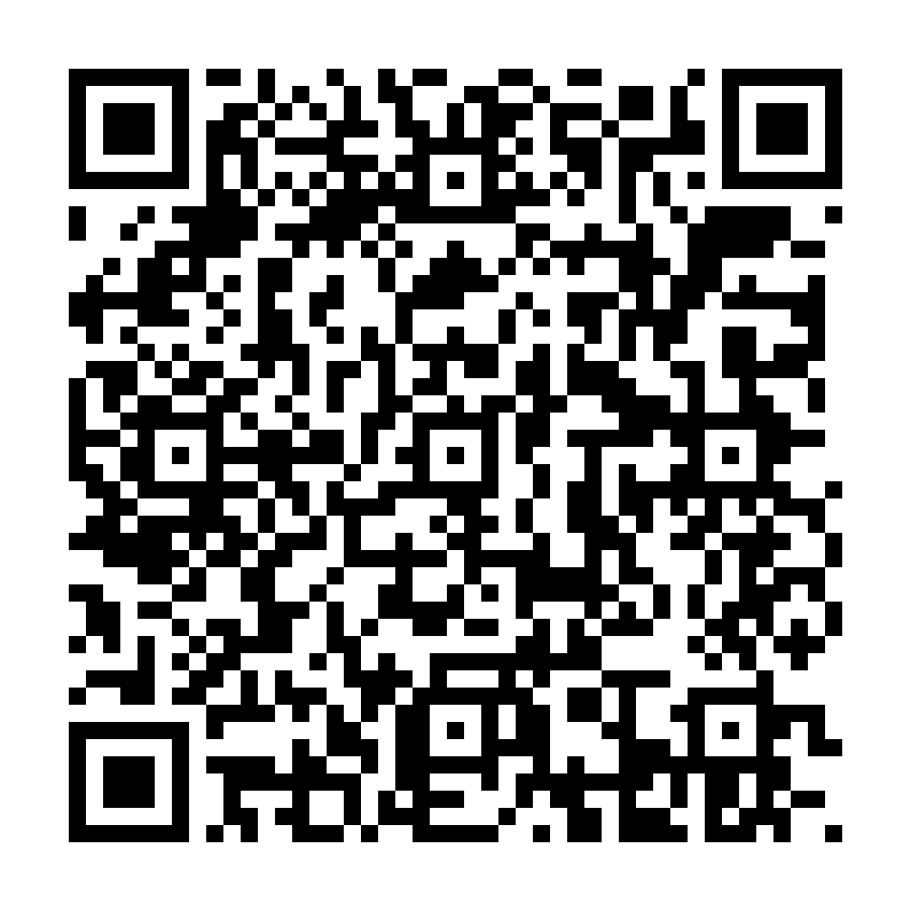

# Pesquisa sobre o curso

Banco de Dados 2 · Aula 8 (26/10/2026)

**Formulário:** [abrir a pesquisa](https://docs.google.com/forms/d/e/1FAIpQLSeziVuY-BWPg_TYHgfDL-wTDkiCM_658eob-gAyt7ktea4JmQ/viewform?usp=publish-editor)

**QR code** (aponta para o formulário acima, para mostrar no projetor): [pesquisa-do-curso-qr.png](pesquisa-do-curso-qr.png)

Texto das perguntas (o formulário já foi montado no Google Forms). A pesquisa é **anônima** (não pedir nome nem e-mail), leva cerca de 5 minutos e serve para o professor ajustar o que
vem pela frente. Não vale nota.

## Perguntas

Escala de 1 a 5 (1 = discordo totalmente, 5 = concordo totalmente), salvo onde indicado.

1. Eu entendo o que está sendo pedido a cada aula.
2. O ritmo das aulas está bom para mim.
3. As aulas em que o professor escreve ao vivo e eu repito no meu projeto me ajudam a aprender.
4. Ver os colegas escreverem a carga do projeto na frente da turma me ajuda.
5. O tempo que tenho para fazer os exercícios é suficiente.
6. Eu me sinto confortável para perguntar quando tenho dúvida.
7. Eu consigo trabalhar no meu projeto com o que foi ensinado até agora.

Escolha uma opção:

8. Como está o seu nível de domínio de SQL agora? (Estou perdido · Faço com ajuda · Faço sozinho · Faço e explico para um colega)
9. O que mais está atrapalhando? (Falta de tempo · Conteúdo difícil · Ritmo rápido · Ferramentas e computador · Nada · Outro)

Respostas curtas (texto livre, opcionais):

10. O que está funcionando bem e deve continuar?
11. O que você mudaria nas aulas?
12. Algum assunto que você gostaria de ver ainda neste curso?

## Como usar

- Publicar o link e o QR code no Classroom antes da aula 8, e mostrar o QR code no projetor às 11:20.
- Mostrar o resultado à turma na aula seguinte (3 minutos): o que mais apareceu e o que o professor vai ajustar.
